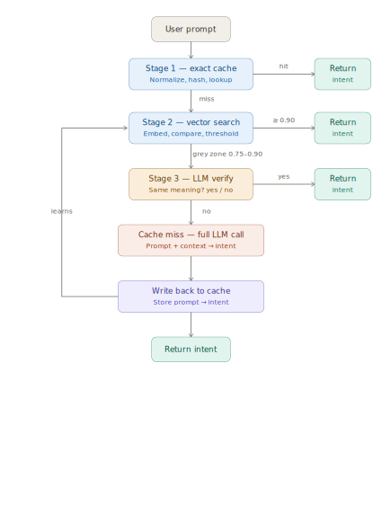
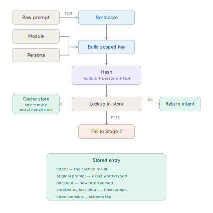
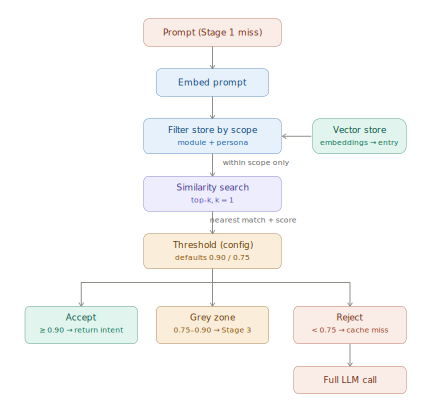
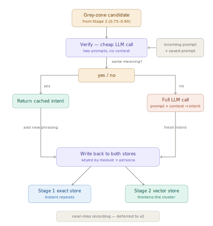

# Spire — Cache Architecture

A three-stage semantic cache that returns a cached **intent** for a prompt without
re-sending the large context bundle to the LLM on every request.

---

## 1. Purpose

In Spire, producing an intent means sending a prompt **plus a large context bundle**
(assembled by `build_context.py` from `context_bundles.yaml`, selected by persona and
module) to the LLM. The prompt is a handful of tokens; the context is the overwhelming
majority of every call. So every call is expensive, and repeated or reworded prompts pay
that cost again and again for what is effectively the same answer.

The cache exists to avoid re-sending the context. Its size is **not** a design parameter —
the cache is size-agnostic. A large context is simply the *reason* caching is worth doing.

The cache has three stages, cheapest first. A prompt exits at the earliest stage that can
answer it:

- **Stage 1** — exact match. Zero LLM cost.
- **Stage 2** — vector similarity within scope. Zero LLM cost on accept.
- **Stage 3** — a cheap two-prompt verification (no context) for borderline matches.
- **Miss** — only a true miss pays the full context cost, and the result is written back so
  the next equivalent prompt hits.

---

## 2. Reference architecture (overview)



Green boxes are exits — the earlier a prompt exits, the cheaper it was. Stage 3's **no** is
the only true cache miss. The **learns** arrow is the write-back: every miss (and every
confirmed Stage 3 match) adds an entry, so the same phrasing exits earlier next time.

Write-back is **automatic**. The guardrails against bad entries are the high Stage 2
threshold and the Stage 3 yes/no check — not a human reviewer.

---

## 3. Scope key and entry shape (shared by all stages)

### Scope key

The cache key is **not** `hash(prompt)`. It is:

```
key = hash(module + persona + normalized_prompt)
```

The intent a prompt produces depends on which context bundle was sent, and the bundle is
chosen by **module + persona**. So the scope key is really "which context produced this
intent." The same words under a different module *or* persona hash to a different key and
land on a different entry — they can never collide.

This is a deliberate no-collision guarantee: more distinct keys, more misses, more LLM
calls are all acceptable; a wrong-meaning collision is not.

### Normalization

Minimal and meaning-preserving only:

- lowercase
- trim
- collapse internal whitespace

Nothing that changes meaning (no synonym folding, no punctuation-stripping that could merge
distinct prompts). Aggressive normalization is exactly what would create collisions, so it
is excluded. Stage 1 is therefore a **narrow** exact-match gate; meaning-level matching is
Stage 2's job.

### Entry shape

Every stored entry — in both stores — carries:

| Field | Purpose |
|---|---|
| `intent` | the cached result |
| `original_prompt` | exact words the user typed (debugging, auditing bad hits) |
| `hit_count` | how often served (identifies hot prompts) |
| `created_at`, `last_hit_at` | timestamps (staleness, cold-entry detection) |
| `intent_version` | schema tag for the intent shape |

---

## 4. Stage 1 — exact cache



Module and persona are folded into the key **before** the hash, so scope is baked into the
lookup. The store is exact-match only — it does no fuzzy work. A hit returns the intent;
a miss falls straight through to Stage 2.

- **Key:** `hash(module + persona + normalized_prompt)`
- **Store:** `key -> entry`, exact match only
- **Hit:** return `intent`
- **Miss:** fall to Stage 2

---

## 5. Stage 2 — vector similarity



The scope filter runs **before** the similarity search. Only same-module, same-persona
entries are ever compared, so cross-scope matches are impossible — the filter removes them
before any distance math runs. This carries the Stage 1 no-collision guarantee into Stage 2.

- **Embed:** the prompt
- **Filter:** vector store by `module + persona`
- **Search:** top-k within scope, **k = 1** for now (held as config so k can widen later
  without reshaping the flow)
- **Threshold:** tunable config, defaults **0.90 / 0.75**
  - `>= 0.90` → **accept**, return intent
  - `0.75 – 0.90` → **grey zone**, hand to Stage 3
  - `< 0.75` → **reject**, cache miss → full LLM call

---

## 6. Stage 3 — verify and write-back



A grey-zone candidate goes to a **cheap** LLM call — just the two prompts (incoming +
saved), no context — asking "same meaning? yes/no." This is what makes Stage 3 affordable:
it touches the LLM but skips the context bundle entirely.

Both outcomes converge on the same **write-back**, which is why the cache learns — every
outcome except a served hit leaves the cache richer.

- **Verify call:** two prompts only, tight yes/no, no context
- **Yes:** return the cached intent; add the new phrasing to **both** stores (exact store =
  instant repeats; vector store = thickens the cluster)
- **No:** fall through to the full LLM call
- **Full LLM call (miss):** produces a fresh intent; write it to **both** stores, keyed by
  scope
- **Near-miss recording:** deferred to v2 (a repeated near-miss simply re-runs one cheap
  verify call for now)

---

## 7. Cache-miss path

Two branches reach the full LLM call: a **Stage 2 reject** (`< 0.75`) and a **Stage 3 no**.
Both run the full call (prompt + context → intent) and then use the **same** write-back
logic as a confirmed learn: the fresh intent is stored in **both** stores, keyed by
`module + persona`. Every intent the LLM produces is cached.

---

## 8. Deferred items

- **Context-version stamp (staleness fix).** The context bundle is not frozen — editing
  `context_bundles.yaml` can change the intent a given prompt should produce, but the cache
  will keep serving intents built from the old bundle (silent staleness). The fix is to
  stamp every entry with a **context version**, bump it when the bundle changes, and have
  Stages 1 and 2 ignore or flush stale-version entries. **Noted, not yet built.**
- **Near-miss recording (v2).** Record confirmed "not the same" prompt pairs so the same
  losing pair isn't re-verified each time.
- **Bulk expansion (optional).** Pre-generate paraphrase variants only for known
  high-frequency prompts. The Stage 3 learning loop is preferred for general coverage — it
  captures phrasings users *actually* send, avoiding the bloat and meaning-drift risk of
  speculative expansion.

