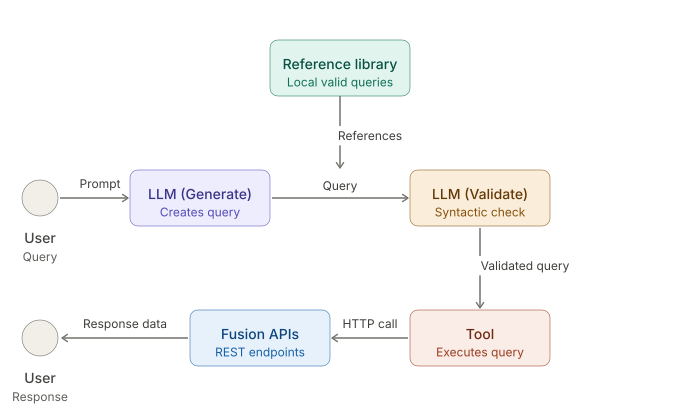
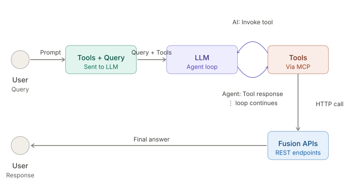
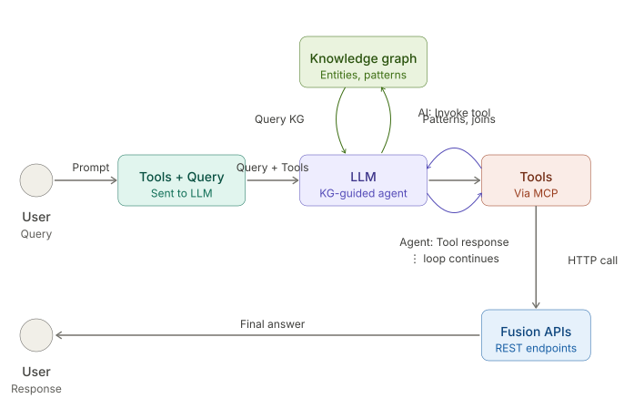
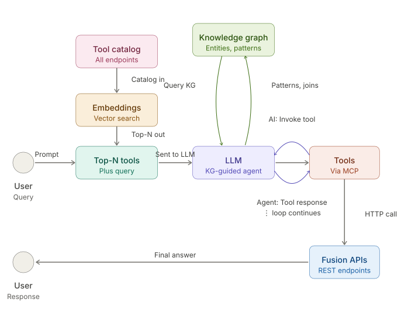

# Spire — Design Alternatives & Comparison

**Purpose:** This document captures the architectural designs considered for Spire's agent layer. Each design is described in its own terms, with an honest assessment of its strengths and limitations, and a visual diagram showing the flow.

**Companion document:** `../spire_poc_master_plan.md` covers the POC plan that tests selected designs against a representative prompt.

**A note on what's built vs. documented:** This document describes four architectural alternatives as conceptual options. The POC itself builds only two of them — Design 2 (Direct Tool Orchestration) as the baseline and Design 4 (Dynamic Orchestration) as the full architecture. Design 3 (Graph-Guided Orchestration) is documented here as a meaningful architectural alternative, but its core component (the Knowledge Graph) is incorporated into Design 4 rather than built as a separate POC phase. See section 9 for the rationale.

---

## Table of Contents

1. [Comparison Reference Prompt](#1-comparison-reference-prompt)
2. [Design 1 — LLM + Reference Query Library + Validation + Tool](#2-design-1--llm--reference-query-library--validation--tool)
3. [Design 2 — Direct Tool Orchestration (Agent Loop)](#3-design-2--direct-tool-orchestration-agent-loop)
4. [Design 3 — Graph-Guided Orchestration](#4-design-3--graph-guided-orchestration)
5. [Design 4 — Dynamic Orchestration](#5-design-4--dynamic-orchestration)
6. [Side-by-Side Comparison](#6-side-by-side-comparison)
7. [Natural Evolution Path](#7-natural-evolution-path)
8. [Recommendation Framework](#8-recommendation-framework)
9. [POC Build Decisions](#9-poc-build-decisions)

---

## 1. Comparison Reference Prompt

All designs are evaluated against the same prompt:

> *Show me suppliers in US with no invoices in 6 months but with open purchase orders, including the buyer assigned to each.*

This prompt deliberately stresses:

- Multiple entities (Supplier, Invoice, PurchaseOrder, Buyer, Address, Country)
- Negation logic (no invoices in 6 months)
- Status semantics (open POs)
- Multi-hop relationships (Supplier → PO → Buyer)
- Organizational scoping (US, resolved via address)

---

## 2. Design 1 — LLM + Reference Query Library + Validation + Tool

**Origin:** The SME's design — a more thoughtful version of "LLM generates the query, tool executes it."

### Key characteristics

- First LLM pass generates a query (typically SQL)
- Second LLM pass validates against reference queries from a local library
- Validation is **syntactic** — no execution
- Tool's role is narrow: just execution
- Reference library is the knowledge source
- Two LLM calls in sequence, but still a single overall pass (no agent loop)

### Pros and Cons

| Pros | Cons |
|---|---|
| Conceptually simple to explain | Reference retrieval is the hidden problem |
| Reference query library is a real asset | Syntactic validation misses semantic errors |
| Validation catches obvious hallucinations | SQL-shaped blind spot — assumes SQL is the answer |
| Modest infrastructure required | No multi-step reasoning |
| Familiar text-to-SQL pattern | No error recovery path |
| Library is human-readable for SMEs | No per-tenant customization layer |
| | Reference library is implicitly a KG, just less queryable |

### When sufficient vs. when it breaks down

| Sufficient when | Breaks down when |
|---|---|
| Question patterns are bounded (~30–50 cover 90% of usage) | Reference library outgrows context window |
| Single-tenant or homogeneous customer base | Customer customizations need accommodation |
| SQL-based access is acceptable | Multi-step orchestration is required |
| Raw errors to users are tolerable | Error recovery and graceful degradation matter |

### A note on its honest position

This is not a naive design. It is a real architecture used in production text-to-SQL systems. The SME's instinct reflects sound engineering caution — *start simple, don't over-build*. The question is whether Spire's product goals exceed what this design can sustain. Its natural evolution under production pressures converges with Designs 2, 3, and 4.

---

## 3. Design 2 — Direct Tool Orchestration (Agent Loop)

**Origin:** The POC's baseline architecture — the version against which more sophisticated designs are measured.

### Key characteristics

- MCP tools wrap Fusion REST endpoints; tools execute against the live pod
- **Critical addition: an agent loop.** The LLM is invoked iteratively, not once.
- Each iteration: LLM sees prompt, tools, history of calls → decides next call or finalize
- Multi-step reasoning is native
- Tool descriptions are the only knowledge surface — no KG, no embeddings

### Pros and Cons

| Pros | Cons |
|---|---|
| Multi-step reasoning works natively | No formal knowledge representation |
| Error recovery built in via the loop | Tool selection accuracy degrades with catalog size |
| Tool call history accumulates signal across iterations | No place for reusable query patterns |
| Standard, well-supported architecture (Cursor, Devin pattern) | No place for per-tenant knowledge |
| Naturally auditable — every iteration is traced | Compounding improvement is limited |
| Endpoint-aware tool selection | Higher infrastructure cost than Design 1 |
| Honest baseline with no extra magic | Loop iterations cost tokens |

### When sufficient vs. when it breaks down

| Sufficient when | Breaks down when |
|---|---|
| Tool catalog is moderate (5–30 tools) | Tool catalog needs to scale toward "all of Fusion" |
| Multi-step reasoning needed but patterns are recurring | Customer customizations need accommodation |
| Single-tenant or homogeneous customer base | Common patterns are wasted re-derivation effort |
| Team prefers operational simplicity over compounding intelligence | Production trust requires verifiable, explainable reasoning |

---

## 4. Design 3 — Graph-Guided Orchestration

**Origin:** An architectural alternative that tests whether structured knowledge meaningfully outperforms tool descriptions alone.

**POC status:** Documented here as a meaningful conceptual step between Designs 2 and 4. The Knowledge Graph it introduces is incorporated into Design 4 rather than built as a separate POC phase. See section 9.

### What's in the Knowledge Graph

Stored in Oracle 26ai as a SQL Property Graph plus supporting relational tables:

- **Entities** — canonical Fusion entities (Supplier, Invoice, PurchaseOrder, Buyer, Address, Country)
- **Relationships** — typed edges with join semantics and endpoint traversal hints
- **Query patterns** — reusable logic ("no Y in N months", "open PO status filter")
- **Lookups** — business-term-to-Oracle-code mappings ("US" → 'US', "open PO" → composite status condition)

### Key characteristics

- Same Fusion execution layer as Designs 1 and 2
- Same agent loop as Design 2
- **Critical addition: a Knowledge Graph the agent consults via dedicated tools**
- KG holds structured knowledge that doesn't fit cleanly in tool docstrings
- Per-tenant overlays are possible (DFFs, custom value sets)

### Pros and Cons

| Pros | Cons |
|---|---|
| Solves the precise traversal problem | Significant upfront design and curation investment |
| Patterns are reusable across entities and queries | Cold-start problem — empty KG provides no value |
| Per-tenant customization has a structured home | New operational surface (mitigated by Oracle 26ai) |
| Negation and complex logic become tractable | Agent integration is non-trivial to tune |
| Explainable — agent can cite KG sources | Risk of over-engineering the model |
| Compounding improvement is natural | Stale or incorrect KG actively misleads the agent |
| Cross-agent knowledge sharing (BIP, OIC, FBDI) | |
| Reduces LLM cognitive load and token cost | |

### When sufficient vs. when overkill

| Sufficient when | Overkill when |
|---|---|
| Product targets real-world Fusion work | Use case is genuinely narrow |
| Common patterns recur across customers | Per-tenant variation doesn't exist |
| Per-tenant customization is a known requirement | Team can't sustain ongoing KG curation |
| Explainability and trust are valued | Time-to-first-demo dominates other concerns |

---

## 5. Design 4 — Dynamic Orchestration

**Origin:** The production-target architecture, addressing the SME's stated requirement for dynamic endpoint addition. Combines Design 3's Knowledge Graph with embedding-based dynamic tool retrieval.

**POC status:** Built as the POC's full architecture. Compared head-to-head against Design 2 (baseline).

### What this design adds

- **Knowledge Graph** (same as Design 3) — encodes entities, relationships, patterns, lookups in Oracle 26ai SQL Property Graph
- **Embedding-based tool retrieval** — full tool catalog embedded in Oracle 26ai's VECTOR data type; only the top-N most relevant tools enter the LLM's context per prompt
- **Endpoints can be added at runtime** — no code changes, no redeploys
- **Pattern matching upgraded to embeddings** — handles synonymy and paraphrase
- **Past successful queries can be embedded** for few-shot retrieval

### Pros and Cons

| Pros | Cons |
|---|---|
| Scales to thousands of endpoints | Most complex of all four designs |
| Dynamic endpoint addition without redeploy | Retrieval quality is a new failure mode |
| Better pattern matching via embeddings | Cold start is more severe |
| Compounding intelligence at the retrieval layer | Embedding model choice matters significantly |
| Solves precise traversal via the KG | Hardest to demo — retrieval happens silently |
| Per-tenant customization via KG overlays | Per-tenant vector store isolation is non-trivial |
| Same operational footprint as a KG-only design (Oracle 26ai handles both) | |
| Production-realistic architecture | |

### When sufficient vs. when overkill

| Sufficient when | Overkill when |
|---|---|
| Product must scale to "all of Fusion" | POC stage with bounded tool catalog only |
| Customers want to add custom endpoints without engineering | Single-customer or single-pod deployment |
| Multi-tenant deployment is in scope | Tool catalog is small and stable |
| Production-grade operations are feasible | Time-to-first-demo dominates |

---

## 6. Side-by-Side Comparison

| Capability | Design 1: Ref Library | Design 2: Direct Tools | Design 3: Graph-Guided | Design 4: Dynamic |
|---|---|---|---|---|
| Tools (execution) | ✅ Yes (narrow role) | ✅ Yes | ✅ Yes | ✅ Yes |
| Agent loop (multi-step) | ❌ No | ✅ Yes | ✅ Yes | ✅ Yes |
| Error recovery | ❌ No | ✅ Built in | ✅ Built in | ✅ Built in |
| Reference query library | ✅ Static file | ⚠️ Could be added | ⚠️ Could be added | ⚠️ Could be added |
| Validation step | ✅ Syntactic only | ⚠️ Implicit via tool errors | ⚠️ Implicit + KG-informed | ⚠️ Implicit + KG-informed |
| Knowledge Graph | ❌ No | ❌ No | ✅ Yes | ✅ Yes |
| Per-tenant customization | ❌ No | ❌ No | ✅ Yes (KG overlays) | ✅ Yes (KG overlays) |
| Embeddings for retrieval | ❌ No | ❌ No | ❌ No | ✅ Yes |
| Tool catalog growth | ❌ Library bloats validation | ⚠️ Degrades at ~30+ tools | ⚠️ Same as Design 2 | ✅ Scales to thousands |
| Dynamic endpoint addition | ❌ No (redeploy) | ❌ No (redeploy) | ❌ No (redeploy) | ✅ Yes |
| Multi-step reasoning | ❌ Single pass | ✅ Native | ✅ Native | ✅ Native |
| Complex logic (negation, joins) | ⚠️ Library-dependent | ⚠️ LLM-derived per call | ✅ Pattern library | ✅ Pattern library |
| Compounding improvement | ⚠️ Manual library curation | ❌ None | ✅ KG enrichment | ✅ KG + past-query embeddings |
| Auditability | ⚠️ Tool-level only | ✅ Full trace | ✅ Full trace + KG citations | ✅ Full trace + KG citations |
| Explainability | ⚠️ Reference queries | ⚠️ Tool descriptions | ✅ KG-cited reasoning | ✅ KG-cited reasoning |
| Time to first demo | ✅ Fast | ⚠️ Moderate | ⚠️ Slower | ❌ Slowest |
| Production-readiness ceiling | ⚠️ Moderate | ⚠️ Moderate-high | ✅ High | ✅ Highest |
| Operational complexity | ✅ Low | ⚠️ Moderate | ⚠️ Higher | ❌ Highest |

Legend: ✅ Strong, ⚠️ Conditional/partial, ❌ Absent or weak

---

## 7. Natural Evolution Path

Each design naturally evolves toward the next under real production pressures.

| Transition | Pressure | Response |
|---|---|---|
| Design 1 → Design 2 | Some queries need iteration the library can't cover | Let the LLM iterate; generate multiple queries; refine on failure |
| Design 2 → Design 3 | Tool descriptions can't carry structured relationship knowledge | Extract that knowledge into a queryable graph |
| Design 3 → Design 4 | Tool catalog must grow toward "all of Fusion" without bloating context | Embed tools; retrieve only relevant ones per prompt |

**Key insight:** No design is "wrong." Each is the right answer for a particular set of constraints. The question is which constraints apply to Spire.

---

## 8. Recommendation Framework

Rather than declaring one design the winner, here are the questions whose answers determine the right choice.

| Question | Answer → Design |
|---|---|
| How large will the tool catalog become? | < 15 tools → Designs 1–3 work; 15–50 → Designs 2 or 3; 50+ → Design 4 |
| Will questions require multi-step reasoning? | Mostly single-step → Design 1; multi-step common → Design 2+ |
| Will customers customize Fusion (DFFs, value sets)? | No → Designs 1 or 2; yes → Design 3 or 4 |
| Is error recovery and graceful degradation important? | Errors can surface raw → Design 1; errors should retry → Design 2+ |
| How important is explainability and audit-grade trust? | Tool-level logging sufficient → any design; citation-able reasoning needed → Design 3 or 4 |
| Should the system improve over time without retraining? | No → Designs 1 or 2; yes → Design 3 or 4 |
| How much operational complexity can the team sustain? | Minimal → Design 1; moderate → Design 2 or 3; production-grade → Design 4 |

### A practical recommendation for Spire specifically

Based on the conversation so far:

- The SME's stated requirement (dynamic endpoint addition) implies **Design 4 is the production destination**
- The build path (incremental, smaller-better-than-larger) implies **starting with Design 2 as the baseline**, then layering Design 4 as the full architecture
- Design 3's value (the KG) is incorporated as a component of Design 4 — see section 9

---

## 9. POC Build Decisions

This section documents which designs are built and which are documented as alternatives only.

### What gets built

| Design | Role in POC | Why |
|---|---|---|
| **Design 2 — Direct Tool Orchestration** | Baseline | Provides a clean, honest measurement of what tool descriptions alone can accomplish. Without this baseline, claims about Design 4's improvements are unfounded. |
| **Design 4 — Dynamic Orchestration** | Full architecture | The production target. Combines the KG (Design 3's contribution) with embedding-based dynamic retrieval. Directly addresses the SME's stated scaling requirement. |

### What does not get built as a separate POC phase

| Design | Why excluded from build |
|---|---|
| **Design 1 — Reference Library + Validation** | The SME's design. Documented here for transparency and to validate that the design conversation considered it. Its limitations (no agent loop, no error recovery, no multi-step reasoning) are well-understood, and its natural evolution converges with Design 2. If a future SME conversation requests it, the master plan can be reframed to include Design 1 as an additional baseline. |
| **Design 3 — Graph-Guided Orchestration** | The KG itself is built — but as a *component* of Design 4, not as a separate POC version. Building Design 3 as its own version would duplicate work, since Design 4 reuses the same KG. Treating the KG integration as one of Design 4's phases keeps the build incremental without requiring a full Design 3 measurement cycle. |

### Why this structure

The original POC plan proposed three versions (baseline, KG, full). On reflection, that structure creates duplicate work: the KG built in version 2 is the same KG used in version 3. Building it twice as separate phases adds overhead without adding signal. By collapsing the KG work into Design 4's phases, the POC delivers the same architectural validation with less ceremony.

The trade-off worth flagging: the original three-version structure made the "is the KG worth it?" question into its own measurable phase. The collapsed structure folds that question into Design 4's overall build — meaning if Design 4 underperforms relative to Design 2, attribution between "the KG didn't help" and "the embeddings didn't help" requires careful trace analysis. This is acceptable for a POC; in production, the KG and embeddings should be evaluated independently.

---

## Document End

This is a living document. As the POC progresses, real measurements should be added to the comparison table (replacing qualitative ✅/⚠️/❌ with quantitative data). Updates should be tracked in version control alongside `../spire_poc_master_plan.md`.

**Last updated:** Document generation date (see git history)