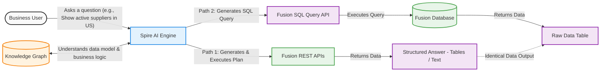
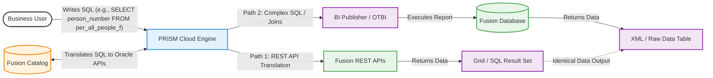
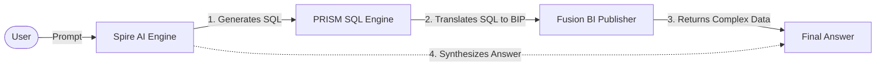
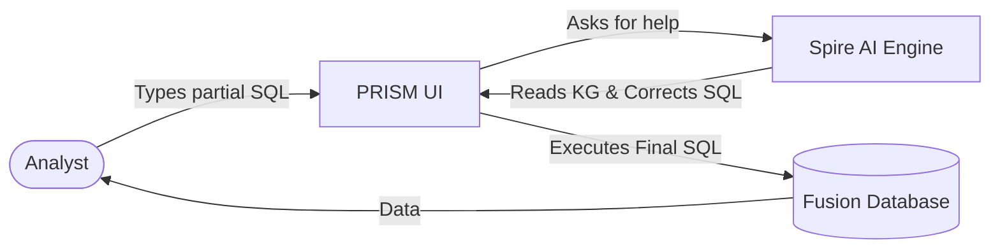
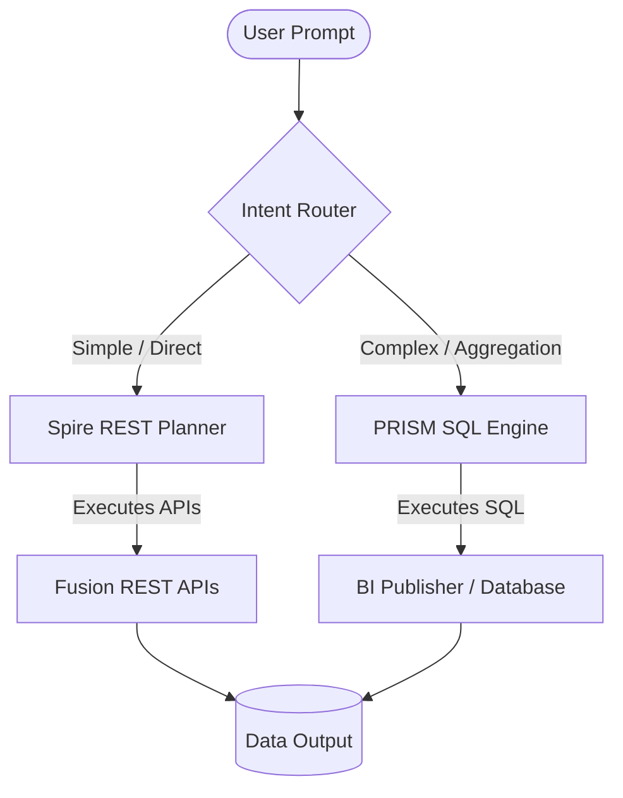

# Spire + PRISM: Unified Enterprise Data Strategy

This document outlines the high-level architecture, comparison, and strategic integration paths for **Spire** (Natural Language pipeline) and **PRISM** (SQL Translation platform).

---

## 1. High-Level Architecture Diagrams

### Spire: Natural Language to Data
Spire acts as an intelligent translator. It takes conversational prompts, uses a Knowledge Graph to understand business logic, and generates the necessary API calls to fetch the data.

### PRISM: SQL to Data
PRISM acts as a database interface over APIs. It takes standard SQL, uses a metadata catalog to map the SQL to Fusion endpoints, and executes the query.

---

## 2. Comparison: Spire vs. PRISM

| Feature / Capability | Spire (NL Pipeline) | PRISM (SQL Connector) |
| :--- | :--- | :--- |
| **Primary Input** | Natural Language ("Show me...") | SQL Query ("SELECT * FROM...") |
| **Target Audience** | Business Users, Executives | Data Analysts, Power Users |
| **Core Technology** | Knowledge Graph + LLM (Parser/Planner) | Metadata Catalog + SQL Parser |
| **Execution Strategy** | Generates API Plans (Deterministic) | Translates SQL to API or BIP |
| **Complex Query Support** | Limited to predefined KG edges | High (Joins, Aggregations via BIP) |
| **Data Guarantee** | Strict anti-hallucination guards | Strict schema mapping |
| **Infrastructure** | Lightweight (CLI / Thin API) | Heavy SaaS (Multi-tenant, Licensing, UI) |

---

## 3. The Uniqueness (Why merge them?)

Individually, both platforms hit a ceiling:
- **Spire’s Ceiling:** It cannot answer highly complex, multi-table analytical questions because building every possible combination into a Knowledge Graph is impossible. 
- **PRISM’s Ceiling:** It requires the user to know SQL. If a CXO asks "What is our spend in EMEA?", they cannot use PRISM unless they know the exact `SELECT` syntax and table names.

**The Merger Value:**
A unified platform allows a user to ask a question in **English**, and if the question is too complex for Spire's REST execution, the platform automatically translates the English into **SQL** and passes it to PRISM's BI Publisher engine to execute a massive join. 

---

## 4. Integration Paths: How to merge them?

There are two distinct ways to architect the merge, depending on which system acts as the "Brain".

### Path A: Spire as the Front-End (NL-to-SQL)
*Best for: Empowering Business Users to run complex analytical reports.*

Spire acts as the natural language layer. When a prompt requires a complex query, Spire uses its Knowledge Graph to generate the SQL, and then executes that SQL via PRISM's engine. 

### Path B: PRISM as the Front-End (SQL + AI Copilot)
*Best for: Giving Data Analysts an AI assistant while they work.*

PRISM remains the primary UI. A data analyst starts writing a SQL query. If they get stuck, they highlight the code and ask Spire (embedded as a Copilot) to "finish this query" or "explain why this is failing." Spire uses its Knowledge Graph to correct the SQL and hands it back to PRISM.

### The Unified Architecture (The End State)
The ultimate goal is a **single unified pipeline**. The system receives the prompt, uses the KG to determine the best execution route, and dynamically switches between API tools and SQL execution based on what the query demands.

