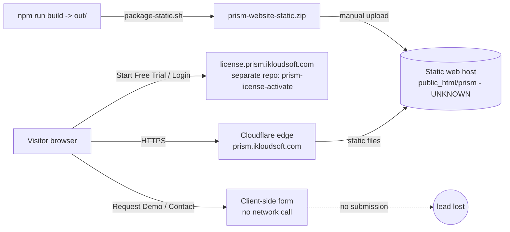
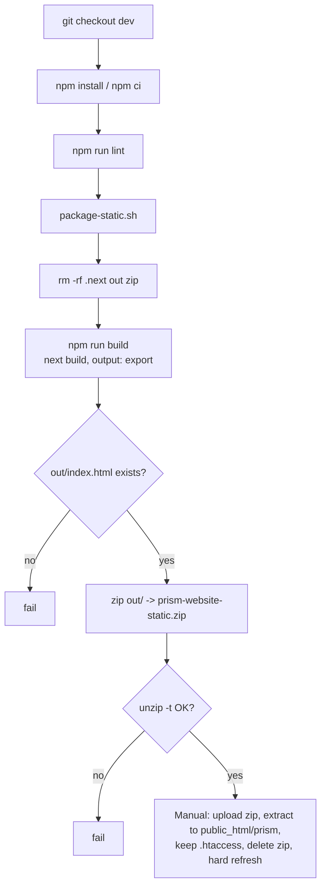
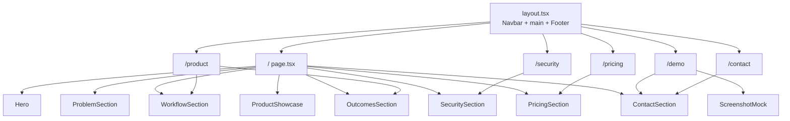
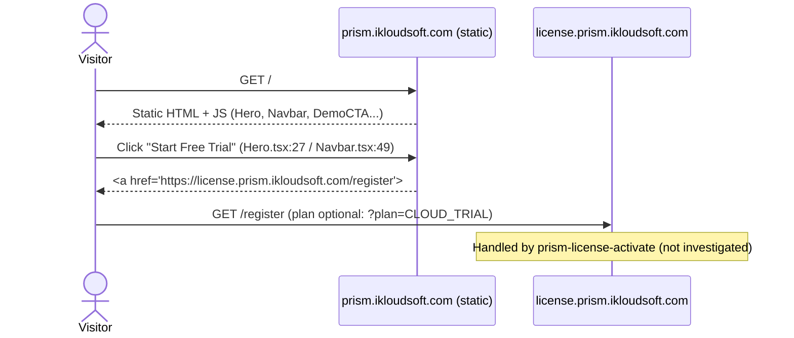

# PRISM Marketing Website: Investigation Report (2026-10-28)

**Repository:** `/home/ikloudsoft1/prism-website` (GitHub: `Ikloudsoft-tech/prism-website`)
**Scope:** Marketing site only. The PRISM application (`fusion-data-explorer`), `prism-license-activate` and `sqllite` were **not** investigated, per instruction. They are referenced only where the VM shows a process or nginx binding that points to them.
**Method:** Read-only. Source reading, `git` inspection, `npm run lint`, and a production build in a **scratch copy** (`/tmp`, now removed). No application code, configuration, deployment, `out/`, `.next/` or zip was modified.

**Classification legend**
- **VERIFIED**: directly observed in source, git, the lockfile, a command run during this investigation, or the live VM.
- **INFERRED**: a reasoned conclusion from verified facts; not tested directly.
- **UNKNOWN**: cannot be determined from the repository or VM; needs input from the owner or hosting team.

Findings are registered in Section 17 with IDs (`F-xx`). Body text cites those IDs.

---

## 1. Executive Summary

- `prism-website` is a **static, client-rendered Next.js 16 marketing site** (App Router, TypeScript, Tailwind CSS 4). It has no backend, no API routes, no database and no authentication. (VERIFIED, F-01, F-02)
- It is built with `output: "export"` into `out/` and packaged as `prism-website-static.zip` by `package-static.sh`. Deployment is a **manual zip upload** to a web host outside this VM. (VERIFIED, F-03, F-20)
- **Lint and production build pass** (lint exit 0; build exit 0, 7 static routes) on the current `dev` HEAD `3196536`. There is **no test suite and no CI pipeline**. (VERIFIED, F-10, F-11)
- The public domain `https://prism.ikloudsoft.com/` returns **HTTP 200** and resolves to Cloudflare addresses. **Nothing on this VM serves it**: no nginx `server_name` and no systemd unit exist for it. (VERIFIED, F-17, F-18)
- **Major functional gap:** the contact/demo form **never sends data**. Submitting only switches the UI to a "Thanks" panel, so every demo request is silently lost. (VERIFIED, F-05)
- **Configuration drift:** the README documents `NEXT_PUBLIC_PRISM_APP_URL`, but the code never reads it. All login and trial links are hard-coded to `license.prism.ikloudsoft.com`. (VERIFIED, F-06, F-07, F-21)
- **Security hygiene:** no secrets are in the repo (`.env*` is git-ignored; only public `NEXT_PUBLIC_*` values are used). A shell-history entry shows a `.env` from another project was printed to the terminal. Treat it as an exposure to review. (VERIFIED, F-28)
- **Handover blockers:** the production hosting provider, target path, DNS/TLS owner, and whether the live content matches commit `3196536` are **UNKNOWN**. See Section 16.

---

## 2. Repository and Git Status

| Item | Value | Tag |
|---|---|---|
| Local path | `/home/ikloudsoft1/prism-website` | VERIFIED |
| Remote | `origin` = `git@github.com:Ikloudsoft-tech/prism-website.git` (fetch and push) | VERIFIED |
| Current branch | `dev`, tracking `origin/dev`, "up to date" | VERIFIED |
| Other branches | `main` (local and `origin/main`) | VERIFIED |
| HEAD | `3196536` feat(marketing): add static deployment packaging script and License Portal integration (2026-07-25, author "Ubuntu") | VERIFIED |
| Previous commits | `442edb0` feat: PRISM marketing website Phase 1 (2026-06-29); `c7a4eeb` Initial commit from Create Next App | VERIFIED |
| Working tree | Clean at the start of the investigation (`git status`). Only this report file is added (untracked). | VERIFIED |
| `main` vs `dev` difference | Not compared | UNKNOWN (F-31) |

Git-ignored local artifacts (present, not tracked): `node_modules/` (470 MB), `.next/`, `out/`, `prism-website-static.zip`, `prism-website.tar.gz`, `.env.local`. Ignore rules are in [.gitignore](/home/ikloudsoft1/prism-website/.gitignore): `/node_modules`, `/.next/`, `/out/`, `*.zip`, `*.tar.gz`, `.env*`, `next-env.d.ts`, `*.tsbuildinfo`.

Stray file: [prism-website.tar.gz](/home/ikloudsoft1/prism-website/prism-website.tar.gz) is 45 bytes. It is a gzip of an **empty tar** (10,240 zero bytes). It serves no purpose. (VERIFIED, F-29)

Commit-to-deployment provenance: `out/` and the zip carry no commit hash or build stamp. Which commit is live is **UNKNOWN**. (INFERRED, F-22)

---

## 3. Project Directory Structure

```text
prism-website/
├── .env.example              # NEXT_PUBLIC_PRISM_APP_URL, NEXT_PUBLIC_CONTACT_EMAIL (keys only)
├── .env.local                # Local copy of the same two keys (git-ignored)
├── .gitignore
├── CLAUDE.md                 # Contains "@AGENTS.md"; AGENTS.md does not exist (F-24)
├── README.md                 # Setup, env vars, pages, components, deployment options
├── eslint.config.mjs         # eslint-config-next core-web-vitals + typescript
├── next.config.ts            # output: "export"  (line 4)
├── next-env.d.ts             # Generated by Next (git-ignored)
├── package.json              # Scripts: dev, build, start, lint
├── package-lock.json         # lockfileVersion 3, 435 entries (52 non-dev)
├── package-static.sh         # Clean -> build -> zip -> unzip -t
├── postcss.config.mjs        # @tailwindcss/postcss
├── tsconfig.json             # strict, paths "@/*" -> "./src/*"
├── prism-website.tar.gz      # Stray empty tar (F-29)
├── prism-website-static.zip  # Deploy artifact (git-ignored), 96 files
├── public/
│   └── screenshots/*.txt     # 4 one-line text placeholders, not PNGs (F-23)
├── out/                      # Static export output (git-ignored)
├── .next/                    # Next build cache/output (git-ignored)
├── node_modules/             # installed packages (470 MB)
└── src/
    ├── app/
    │   ├── layout.tsx        # Root layout, metadata, Inter font, Navbar + Footer
    │   ├── page.tsx          # "/" home
    │   ├── globals.css
    │   ├── favicon.ico
    │   ├── product/page.tsx  # "/product"
    │   ├── demo/page.tsx     # "/demo"
    │   ├── security/page.tsx # "/security"
    │   ├── pricing/page.tsx  # "/pricing"
    │   └── contact/page.tsx  # "/contact"
    └── components/           # 13 components (see Section 6)
```

No `src/app/api/`, no `middleware.ts`, no `.github/`, no test directories and no Dockerfile or server config exist in the repo. (VERIFIED, F-02, F-10)

---

## 4. Technology Stack

| Layer | Technology | Version (installed / lock) | Source | Tag |
|---|---|---|---|---|
| Framework | Next.js (App Router, Turbopack build) | 16.2.9 | package.json; build output | VERIFIED |
| UI runtime | React / React DOM | 19.2.4 | package.json | VERIFIED |
| Language | TypeScript (strict) | 5.9.3 | node_modules | VERIFIED |
| Styling | Tailwind CSS + `@tailwindcss/postcss` | 4.3.2 | node_modules | VERIFIED |
| Lint | ESLint 9.39.4 + `eslint-config-next` 16.2.9 | 9.39.4 | node_modules | VERIFIED |
| Fonts | Inter via `next/font/google` (build-time download) | n/a | [layout.tsx](/home/ikloudsoft1/prism-website/src/app/layout.tsx) lines 2, 7-10 | VERIFIED |
| Hosting (target) | Static files on a web host (zip upload) | n/a | [package-static.sh](/home/ikloudsoft1/prism-website/package-static.sh) deploy steps | INFERRED (F-20) |
| Runtime (VM) | Node.js v22.22.2, npm 10.9.7 | n/a | `node -v`, `npm -v` on VM | VERIFIED |

---

## 5. Architecture and Design

The site is a **build-time static export**. There is no server runtime, and the only dynamic behaviour is client-side (`"use client"` components for the navbar, pricing/contact interactions and the form).

### 5.1 System context



### 5.2 Build and release pipeline



### 5.3 Routing and page composition



Source: [page.tsx](/home/ikloudsoft1/prism-website/src/app/page.tsx) (line 11), [product/page.tsx](/home/ikloudsoft1/prism-website/src/app/product/page.tsx) (lines 28, 30), [demo/page.tsx](/home/ikloudsoft1/prism-website/src/app/demo/page.tsx) (lines 39, 47), [security/page.tsx](/home/ikloudsoft1/prism-website/src/app/security/page.tsx) (line 27), [pricing/page.tsx](/home/ikloudsoft1/prism-website/src/app/pricing/page.tsx) (line 27), [contact/page.tsx](/home/ikloudsoft1/prism-website/src/app/contact/page.tsx) (line 22). (VERIFIED, F-02)

### 5.4 Design observations

- **Single source of links:** each component declares its own `LICENSE_PORTAL` constant instead of reading config (Navbar.tsx line 6, PricingSection.tsx line 3). Changing the portal domain needs code edits in several files. (VERIFIED, F-07)
- **Form duplication:** `ContactSection` is reused on `/demo` and `/contact`, so one client-only form serves two entry points. (VERIFIED, F-05)

---

## 6. Major Components and Responsibilities

| Component | File | Responsibility | Key lines / notes |
|---|---|---|---|
| RootLayout | [layout.tsx](/home/ikloudsoft1/prism-website/src/app/layout.tsx) | HTML shell, SEO metadata, Inter font | Metadata 12-33; RootLayout 35-49 |
| Navbar | [Navbar.tsx](/home/ikloudsoft1/prism-website/src/components/Navbar.tsx) | Fixed top nav, mobile menu; Login/Start Free Trial to license portal | Portal const line 6; desktop links 43, 49; mobile 93, 99 |
| Footer | [Footer.tsx](/home/ikloudsoft1/prism-website/src/components/Footer.tsx) | Site links, trial and login links | Portal links 32-33 |
| Hero | [Hero.tsx](/home/ikloudsoft1/prism-website/src/components/Hero.tsx) | Landing headline, CTAs | Trial link 27, 79 |
| ProblemSection | [ProblemSection.tsx](/home/ikloudsoft1/prism-website/src/components/ProblemSection.tsx) | Three problem cards | Static content |
| WorkflowSection | [WorkflowSection.tsx](/home/ikloudsoft1/prism-website/src/components/WorkflowSection.tsx) | Five-step flow | Static content |
| ProductShowcase | [ProductShowcase.tsx](/home/ikloudsoft1/prism-website/src/components/ProductShowcase.tsx) | Product screenshots and descriptions | Uses ScreenshotMock |
| OutcomesSection | [OutcomesSection.tsx](/home/ikloudsoft1/prism-website/src/components/OutcomesSection.tsx) | Business outcome metrics | Static content |
| SecuritySection | [SecuritySection.tsx](/home/ikloudsoft1/prism-website/src/components/SecuritySection.tsx) | Five security feature cards | Claims at lines 8-45 (F-27) |
| PricingSection | [PricingSection.tsx](/home/ikloudsoft1/prism-website/src/components/PricingSection.tsx) | Three plans; trial link with `?plan=CLOUD_TRIAL` | Plans 5-46; trial href line 16; contact line 29; "Coming Soon" `href="#"` lines 41-44 |
| ContactSection | [ContactSection.tsx](/home/ikloudsoft1/prism-website/src/components/ContactSection.tsx) | Lead form (name, company, email, module, message) | Email env line 5; `handleSubmit` 20-23; form 57; mailto 38 |
| DemoCTA | [DemoCTA.tsx](/home/ikloudsoft1/prism-website/src/components/DemoCTA.tsx) | Bottom banner: trial and demo | Trial link line 14 |
| CTAButton | [CTAButton.tsx](/home/ikloudsoft1/prism-website/src/components/CTAButton.tsx) | Primary/secondary button; `http...` uses `<a>`, others `next/link` | Line 17 (`isExternal`) |
| ScreenshotMock | [ScreenshotMock.tsx](/home/ikloudsoft1/prism-website/src/components/ScreenshotMock.tsx) | CSS-only placeholder for screenshots | Real screenshots absent (F-23) |

Pages: `/` (home), `/product`, `/demo` (screenshot grid + ContactSection), `/security`, `/pricing`, `/contact` (ContactSection). Each has `metadata.title` ("... — PRISM"). (VERIFIED)

---

## 7. Application Workflows

### 7.1 Visitor to trial signup (outbound)



### 7.2 Demo or contact request (broken end-to-end)

```mermaid
sequenceDiagram
    actor V as Visitor
    participant F as ContactSection (client)
    V->>F: Fill name, company, email (required), module, message
    V->>F: Click "Send Message" (type=submit)
    F->>F: handleSubmit: preventDefault(); setSubmitted(true)
    F-->>V: "Thanks for reaching out! Our team will contact you shortly."
    Note over F: No fetch, no form action, no mailto. Data is discarded. (F-05)
```

### 7.3 Build and package (release)

1. `npm install` (or `npm ci`) installs from `package-lock.json`.
2. `npm run lint` runs `eslint` with `eslint.config.mjs`.
3. `./package-static.sh` deletes `.next`, `out` and the zip, runs `npm run build`, checks `out/index.html`, zips `out/`, and runs `unzip -t`.
4. A human uploads the zip to the host, extracts it into `public_html/prism`, keeps `.htaccess`, deletes the zip and hard-refreshes (steps printed by the script). (VERIFIED, F-20)

### 7.4 Operator trial-signup link check (manual)

Shell history shows `dig` and `curl -I` were previously run against `license.prism.ikloudsoft.com` as a manual check. (VERIFIED, from `~/.bash_history`)

---

## 8. APIs and Integrations

| Integration | Where | Type | Status | Tag |
|---|---|---|---|---|
| License Portal (register, login) | Navbar.tsx 6, 43, 49, 93, 99; PricingSection.tsx 3, 16; Hero.tsx 27, 79; DemoCTA.tsx 14; Footer.tsx 32-33 | Outbound hyperlinks | Hard-coded `https://license.prism.ikloudsoft.com` | VERIFIED (F-07) |
| Mail (contact) | ContactSection.tsx 5, 38 | `mailto:` link only | Default `sales@ikloudsoft.com`; `NEXT_PUBLIC_CONTACT_EMAIL` overrides at build time | VERIFIED (F-08) |
| PRISM App URL | README.md line 62 only | Documented but **unused** in code | `NEXT_PUBLIC_PRISM_APP_URL` not referenced in `src/` | VERIFIED (F-06) |
| Lead capture backend | ContactSection.tsx 20-23 | None | No endpoint, no `fetch` | VERIFIED (F-05) |
| Google Fonts (Inter) | layout.tsx 2, 7 | Build-time download via `next/font/google` | Requires network at build | INFERRED (F-19) |
| Analytics / third-party scripts | Source | None found in `src/` (not exhaustively checked for `<script>`) | - | INFERRED |

There are **no HTTP API routes, webhooks, auth flows or database connections** in this repository. (VERIFIED, F-02)

---

## 9. Database and Data Model

**Not applicable.** The site has no database, ORM, migrations or persisted data. Form values are not stored anywhere, including in `localStorage`. (VERIFIED, F-02, F-05)

Client-side form model (in `ContactSection`, uncontrolled inputs): `name` (required), `company` (required), `email` (required, type email), `modules` (select: HCM, Finance, SCM, Procurement, Projects, Manufacturing, Other), `message` (optional). (VERIFIED)

---

## 10. Complete Dependency Inventory

### 10.1 Direct dependencies (from [package.json](/home/ikloudsoft1/prism-website/package.json) and [package-lock.json](/home/ikloudsoft1/prism-website/package-lock.json))

| Package | Spec | Resolved (lock) | Type | License | Tag |
|---|---|---|---|---|---|
| next | 16.2.9 | 16.2.9 | runtime | MIT | VERIFIED |
| react | 19.2.4 | 19.2.4 | runtime | MIT | VERIFIED |
| react-dom | 19.2.4 | 19.2.4 | runtime | MIT | VERIFIED |
| @tailwindcss/postcss | ^4 | 4.3.2 | dev | MIT | VERIFIED |
| @types/node | ^20 | 20.19.43 | dev | MIT | VERIFIED |
| @types/react | ^19 | 19.2.17 | dev | MIT | VERIFIED |
| @types/react-dom | ^19 | 19.2.3 | dev | MIT | VERIFIED |
| eslint | ^9 | 9.39.4 | dev | MIT | VERIFIED |
| eslint-config-next | 16.2.9 | 16.2.9 | dev | MIT | VERIFIED |
| tailwindcss | ^4 | 4.3.2 | dev | MIT | VERIFIED |
| typescript | ^5 | 5.9.3 | dev | Apache-2.0 | VERIFIED |

### 10.2 Transitive dependencies

The lockfile has **435 entries** (lockfileVersion 3). **52** are non-dev (runtime). The full transitive list is the lockfile itself. Regenerate it with:

```bash
cd /home/ikloudsoft1/prism-website
node -e 'const l=require("./package-lock.json");for(const[k,v]of Object.entries(l.packages)){if(k)console.log(k.replace(/^node_modules\//,""),v.version,v.license||"")}'
```

`node_modules/` is 470 MB on disk. The lockfile is the authoritative list; do not count installed directories. (VERIFIED, F-30)

### 10.3 Dependency observations

- No `engines` or `packageManager` field pins the Node or npm version. The VM runs Node 22.22.2. (VERIFIED, F-26)
- No vulnerability audit (`npm audit`) was run. (UNKNOWN, F-31)
- Versions are current major lines, but Next.js 16 is recent. Check the release notes before upgrading. (INFERRED)

---

## 11. VM Infrastructure and Runtime

### 11.1 Host facts (VERIFIED on this VM, 2026-10-28)

| Item | Observation |
|---|---|
| Node / npm | v22.22.2 / 10.9.7 |
| Likely host | Azure VM (commit author hostname contains `cloudapp.net`) | INFERRED |
| Listening (public) | 80, 443 (nginx) | VERIFIED |
| Listening (local) | 3000 (`serve -s dist`, cwd `/home/ikloudsoft1/prism-license-activate`), 3001 (`serve -s dist`, cwd `/home/ikloudsoft1/fusion-data-explorer/frontend`), 8000 (uvicorn, `prism-license-activate/backend`) | VERIFIED |
| nginx sites enabled | `app.prism.ikloudsoft.com`, `license.prism.ikloudsoft.com`, `mcp.ikloudsoft.com` | VERIFIED |
| Marketing site nginx block | **None** for `prism.ikloudsoft.com` | VERIFIED (F-17) |
| prism-website systemd unit | **None** | VERIFIED (F-18) |
| Relevant systemd units | `prism-license-activate.service` (3000, user ikloudsoft1), `prism-license-backend.service`, `fusion-frontend.service`, `fusion-backend.service`, `nginx.service` | VERIFIED |

### 11.2 Where the marketing site is served

`prism.ikloudsoft.com` responds **HTTP 200** and resolves to `172.67.184.95` and `104.21.19.7`, which are Cloudflare ranges. The VM does not serve it. Therefore the live site is hosted elsewhere. (VERIFIED for response and DNS; host identity INFERRED, F-17, F-20)

### 11.3 Runtime notes

- The site needs **no runtime process** in production (static files only). Node is needed only for building. (VERIFIED, from `output: "export"`)
- `.env.local` values are inlined into the bundle at build time (`NEXT_PUBLIC_*`). Changing them requires a rebuild and a re-upload. (INFERRED, F-19)

---

## 12. Build, Test, and Deployment Procedures

All commands are run from `/home/ikloudsoft1/prism-website`.

### 12.1 Setup

```bash
cd /home/ikloudsoft1/prism-website
npm ci                       # or: npm install (lockfile v3)
cp -n .env.example .env.local   # only if .env.local is missing; never commit it
```
Status: `npm run lint` and `npm run build` were executed successfully in a scratch copy using a copy of `node_modules`. `npm ci` was not executed on the repo, so **INFERRED** for that step.

### 12.2 Development server

```bash
npm run dev                  # http://localhost:3000
```
Status: **INFERRED**. Not executed. Port 3000 is already used on this VM by the license portal's `serve` process, so Next will move to another port or fail. Use `npm run dev -- -p 3100` if needed.

### 12.3 Lint (VERIFIED)

```bash
npm run lint                 # eslint (no args), exit 0 on 2026-10-28
```

### 12.4 Build (VERIFIED)

```bash
npm run build                # next build, exit 0 on 2026-10-28
```
Verified output: Turbopack compile, TypeScript, 7 static routes (`/`, `/_not-found`, `/contact`, `/demo`, `/pricing`, `/product`, `/security`), `○ (Static)`.

### 12.5 Tests (UNKNOWN / none)

There is **no test script** and **no test files**. `npm test` does not exist. Verify changes by lint, build and a manual browser check. (VERIFIED, F-10)

### 12.6 Package for deployment

```bash
./package-static.sh          # NOT executed during this investigation (it deletes .next, out and the zip)
unzip -l prism-website-static.zip | tail -1    # 96 files, 1,764,004 bytes (VERIFIED)
```

### 12.7 Manual deployment (from the script's printed steps)

1. Upload `prism-website-static.zip` to the web host.
2. Extract into `public_html/prism`.
3. Keep the existing `.htaccess`.
4. Delete the ZIP after extraction.
5. Hard-refresh the browser.

The target host, credentials and exact procedure are **UNKNOWN** to this repository. (UNKNOWN, F-20)

### 12.8 Post-deploy verification (VERIFIED command)

```bash
curl -sS -o /dev/null -m 15 -w "%{http_code}\n" https://prism.ikloudsoft.com/   # returned 200
curl -sS -o /dev/null -m 15 -w "%{http_code}\n" https://prism.ikloudsoft.com/pricing
```
(The second URL was not run; **INFERRED** from the static routes.)

### 12.9 Local static preview (INFERRED)

```bash
python3 -m http.server 8080 --directory out   # not executed
```

---

## 13. Security and Operational Risks

| # | Risk | Severity | Evidence | Tag |
|---|---|---|---|---|
| R1 | **Leads are lost.** The contact/demo form has no submit target. Prospects receive a "we'll contact you" message that is never acted on. | High (business) | ContactSection.tsx 20-23 | VERIFIED (F-05) |
| R2 | **Credential exposure in shell history.** `~/.bash_history` contains a `cat` of a `.env` file from `prism-license-activate`. Its contents are not recorded here. | High | `.bash_history` (command present) | VERIFIED (F-28) |
| R3 | **Hard-coded portal URLs.** Domain changes need code edits and a rebuild. | Medium | Navbar.tsx 6; PricingSection.tsx 3; others | VERIFIED (F-07) |
| R4 | **Documentation drift.** README documents an unused variable, a wrong default app URL and `npm start` behind nginx, which conflicts with `output: "export"`. | Medium | README.md "Environment Variables", "Deployment Options" sections; next.config.ts 4 | VERIFIED (F-06, F-21) / INFERRED for `npm start` (F-25) |
| R5 | **No security headers defined in the repo.** CSP, HSTS and X-Frame-Options depend on the host, which is unknown. | Medium | No server config in repo | INFERRED (F-34) |
| R6 | **Unverified security marketing claims** ("Encrypted Credentials", "Tenant Isolation", "Secure BIP Integration") appear on the public security page. Overclaiming is a legal and reputational risk. | Medium | SecuritySection.tsx 8-45; security/page.tsx 7 | UNKNOWN (F-27) |
| R7 | **No dependency audit or CI.** Vulnerabilities and broken builds are not caught automatically. | Medium | No CI config; `npm audit` not run | VERIFIED / UNKNOWN (F-10, F-31) |
| R8 | **Build-time env inlining.** `NEXT_PUBLIC_CONTACT_EMAIL` is public. Do not place secrets in any `NEXT_PUBLIC_*` variable. | Low | ContactSection.tsx 5 | VERIFIED (F-08) |
| R9 | **Deployment provenance.** Live content cannot be tied to a commit. Manual zip upload is error-prone. | Medium | package-static.sh; no build stamp | INFERRED (F-22) |
| R10 | **Stale/unused artifacts.** Empty `prism-website.tar.gz`, placeholder `.txt` "screenshots", broken `CLAUDE.md` import. | Low | Files in root and `public/` | VERIFIED (F-23, F-24, F-29) |
| R11 | **Placeholder "Coming Soon" plan** links to `#`. | Low | PricingSection.tsx 41-44 | VERIFIED (F-09) |

---

## 14. Cross-Repository Dependencies

| Dependency | Direction | Evidence | Tag |
|---|---|---|---|
| `license.prism.ikloudsoft.com` (register, login, trial) | Marketing site links **out** to it | Navbar, Hero, DemoCTA, Footer, PricingSection | VERIFIED (F-07) |
| `prism-license-activate` repo (`/home/ikloudsoft1/prism-license-activate`) | Serves the license portal (frontend on 3000, backend on 8000 via nginx `/api/` and `/health`) | systemd unit cwd; `/proc` cwd; nginx `license.prism.ikloudsoft.com` | VERIFIED for ports and paths. **Not investigated**, per instruction (F-16) |
| `fusion-data-explorer` (PRISM app, `app.prism.ikloudsoft.com`) | Documented as the app domain in README ("Domain Mapping"); the marketing site does not link to it | app nginx site proxies `/` to 127.0.0.1:3001 and `/api` to 127.0.0.1:8081 | VERIFIED for README/nginx; not investigated (F-16) |
| `sqllite` repository | None observed with this site | - | UNKNOWN (not investigated) |
| Lead backend (CRM / email service) | Expected, not implemented | ContactSection.tsx | VERIFIED absent (F-05) |

---

## 15. Troubleshooting and Operational Runbook

| Symptom | Likely cause | Check / fix | Tag |
|---|---|---|---|
| Build fails: `Symlink [project]/node_modules is invalid, it points out of the filesystem root` | `node_modules` is a symlink. Turbopack rejects it. | Replace the symlink with a real directory (`npm ci`). **Reproduced** during this investigation. | VERIFIED |
| `package-static.sh` fails with "Build failed: out/index.html not found" | `next build` failed or `output: "export"` was removed | Run `npm run build` alone and read the error. | VERIFIED (script logic) |
| "ZIP integrity check failed" | Interrupted zip | Re-run `./package-static.sh` | VERIFIED (script logic) |
| Contact or demo request never reaches sales | No backend (by design today) | Expected behaviour. Fix requires a backend or third-party form service. | VERIFIED |
| Changed `NEXT_PUBLIC_CONTACT_EMAIL` but site unchanged | Value is inlined at build time | Rebuild and re-upload. | INFERRED |
| Login/trial links point to the wrong domain | Hard-coded URLs in several components | Edit the constants listed in Section 8, then rebuild. | VERIFIED |
| `npm run dev` fails with port in use | Port 3000 is used by the license portal `serve` process on this VM | `npm run dev -- -p 3100` | VERIFIED (port usage) / INFERRED (fix) |
| `prism.ikloudsoft.com` shows old content after deploy | Browser or CDN cache | Hard refresh. Purge the CDN cache (Cloudflare) if configured. | INFERRED |
| Site is down | Host or Cloudflare problem, not this VM | `curl -sS -I https://prism.ikloudsoft.com/`. Check the hosting account. | UNKNOWN (host) |
| `npm start` errors with `output: "export"` | Static export has no Next server | Serve `out/` with any static server. | INFERRED |

---

## 16. Handover Readiness and Missing Information

**Ready now (VERIFIED):** source is clean and committed; lint and build pass; packaging script exists and was run at least once (shell history); dependencies are locked; no secrets were found in the repo's tracked files.

**Not ready (blockers):**

| # | Missing item | Why it matters | Tag |
|---|---|---|---|
| H1 | Production host, provider account and the exact path for `prism.ikloudsoft.com` | Required to deploy or roll back | UNKNOWN (F-20) |
| H2 | DNS, Cloudflare and TLS certificate owner | Required for domain changes | UNKNOWN (F-17) |
| H3 | Which commit is live | Required for audits and rollbacks | UNKNOWN (F-22) |
| H4 | Lead-capture backend or form service decision | Demo and contact requests are lost today | VERIFIED gap (F-05) |
| H5 | Sign-off that claims on `/security`, `/pricing` and the home page are accurate | Legal and sales accuracy | UNKNOWN (F-27) |
| H6 | Real screenshots (`public/screenshots/*.png`) | README says to replace placeholders | VERIFIED gap (F-23) |
| H7 | Test strategy, CI and dependency audit | No automated quality gate | UNKNOWN (F-10, F-31) |
| H8 | Whether `main` and `dev` differ | Release branch unclear | UNKNOWN (F-31) |
| H9 | The `.htaccess` content on the host | The script says to keep it, so it may hold rules that matter | UNKNOWN (F-20) |

---

## 17. Evidence References and Open Questions

### 17.1 Findings register

Each row is one finding. The **Tag** column uses only `VERIFIED`, `INFERRED` or `UNKNOWN`.

| ID | Finding | Evidence | Tag |
|---|---|---|---|
| F-01 | Static, client-rendered Next.js 16 marketing site | package.json; next.config.ts:4 | VERIFIED |
| F-02 | No backend, API routes, middleware or database | File tree; `src/app` contents | VERIFIED |
| F-03 | Static export to `out/`, zipped by package-static.sh | next.config.ts:4; package-static.sh | VERIFIED |
| F-04 | Lint passes (exit 0) | `npm run lint` | VERIFIED |
| F-05 | Contact/demo form has no submission target | ContactSection.tsx:20-23 | VERIFIED |
| F-06 | `NEXT_PUBLIC_PRISM_APP_URL` documented but unused | README.md:62; grep of `src/` | VERIFIED |
| F-07 | License portal URLs hard-coded in multiple components | Navbar.tsx:6; PricingSection.tsx:3; Hero.tsx; DemoCTA.tsx; Footer.tsx | VERIFIED |
| F-08 | `NEXT_PUBLIC_CONTACT_EMAIL` used, default `sales@ikloudsoft.com` | ContactSection.tsx:5 | VERIFIED |
| F-09 | Desktop Lite plan is "Coming Soon" with `href="#"` | PricingSection.tsx:41-44 | VERIFIED |
| F-10 | No tests, no test script, no CI config | package.json; file listing | VERIFIED |
| F-11 | Production build passes (7 static routes) | `npm run build` in scratch copy | VERIFIED |
| F-12 | Git: branch `dev`, clean, HEAD `3196536`, remote GitHub | `git status`, `git log`, `git remote -v` | VERIFIED |
| F-13 | `CTAButton` routes external `http` links to `<a>` and internal links to `next/link` | CTAButton.tsx:17-31 | VERIFIED |
| F-14 | Form fields and module list | ContactSection.tsx:7-15, 59-130 | VERIFIED |
| F-15 | Pages and their components | `src/app/*/page.tsx` | VERIFIED |
| F-16 | Cross-repo ports and paths for the license portal and PRISM app (process and nginx facts only) | `/proc` cwd, systemd units, nginx sites | VERIFIED |
| F-17 | No nginx block for `prism.ikloudsoft.com` on this VM | `/etc/nginx/sites-enabled` listing and grep | VERIFIED |
| F-18 | No systemd unit for the marketing site | `systemctl list-units` | VERIFIED |
| F-19 | Build inlines `NEXT_PUBLIC_*` values; Inter fonts download at build time | layout.tsx:2, 7; Next.js behaviour | INFERRED |
| F-20 | Deployment is a manual zip upload to `public_html/prism`; host unknown | package-static.sh deploy steps | INFERRED |
| F-21 | README app URL default (`app.prism...`) differs from links used (license portal) | README.md:62 vs Navbar/Hero | VERIFIED |
| F-22 | Live content cannot be tied to a commit | No build stamp in `out/` | INFERRED |
| F-23 | Screenshots are one-line `.txt` placeholders, not images | `public/screenshots/*.txt`; README.md | VERIFIED |
| F-24 | `CLAUDE.md` imports `@AGENTS.md`, which does not exist | CLAUDE.md; `ls` | VERIFIED |
| F-25 | `npm start` conflicts with `output: "export"` (not tested) | next.config.ts:4; README "Deployment Options" | INFERRED |
| F-26 | No `engines` or `packageManager` field | package.json | VERIFIED |
| F-27 | Security page claims are not verifiable from this repo | SecuritySection.tsx:8-45 | UNKNOWN |
| F-28 | Shell history shows a `.env` from another project was printed to the terminal (contents not recorded) | `~/.bash_history` | VERIFIED |
| F-29 | `prism-website.tar.gz` is an empty tar in gzip (45 bytes) | `gzip -dc` = 10,240 bytes | VERIFIED |
| F-30 | Lockfile v3: 435 entries, 52 non-dev | package-lock.json | VERIFIED |
| F-31 | Not checked: `main` vs `dev` diff, `npm audit`, `npm ci` on repo | Not run | UNKNOWN |
| F-32 | `out/` and the zip match each other exactly | `diff -rq` of unzipped zip vs `out/` | VERIFIED |
| F-33 | Public site returns HTTP 200 and resolves to Cloudflare IPs | `curl`, `dig` | VERIFIED |
| F-34 | Hosting provider, target path, `.htaccess`, DNS and TLS owner | Not in repo or VM | UNKNOWN |
| F-35 | Whether live content equals commit `3196536` | Not checkable without host access | UNKNOWN |
| F-36 | Turbopack build fails if `node_modules` is a symlink (reproduced) | Scratch build error | VERIFIED |
| F-37 | Marketing copy claims (30-day trial, no card, metrics) are not backed by this repo | DemoCTA.tsx:43; PricingSection.tsx:8; OutcomesSection.tsx | UNKNOWN |
| F-38 | Dev server port conflict with license portal on 3000 (by port ownership) | `ss` output; systemd | INFERRED |

### 17.2 Open questions for the owner

1. Which hosting account and path serve `prism.ikloudsoft.com`, and who owns Cloudflare and DNS?
2. Where should contact and demo submissions go (CRM, email service, or a form provider)?
3. Should the portal and app URLs become configuration rather than hard-coded?
4. Who approves the security and pricing claims?
5. Is `main` the release branch, and is `dev` ahead of it?
6. Should the `.bash_history` exposure (F-28) be treated as a secret-rotation event?

### 17.3 Investigation limits

- `prism-license-activate` and `sqllite` were not investigated, as instructed.
- No changes were made to the application, configuration, deployment, `out/`, `.next/` or the zip.
- The production build was verified in a temporary copy, which was then deleted.
- This report is the only file created. It is untracked in git.
